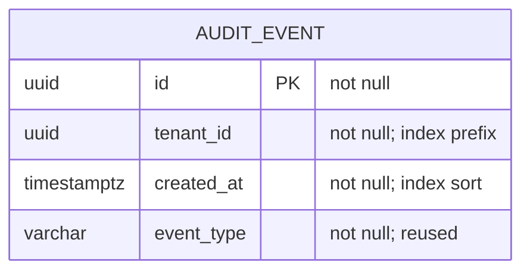
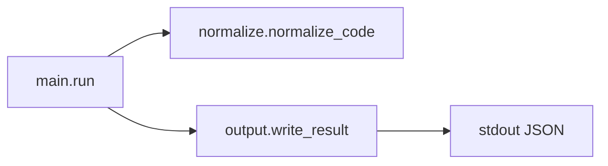
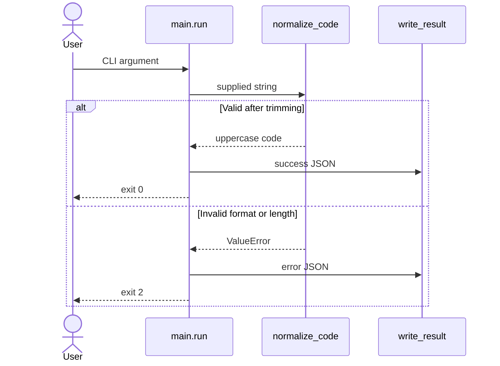
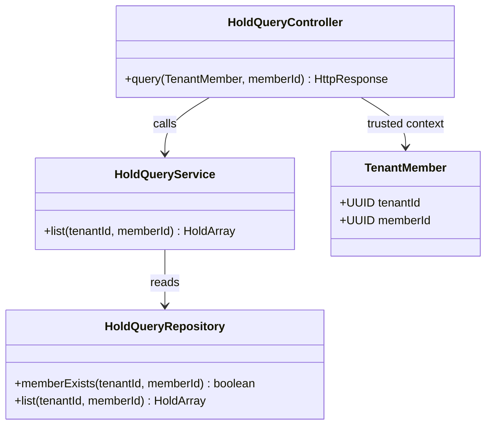
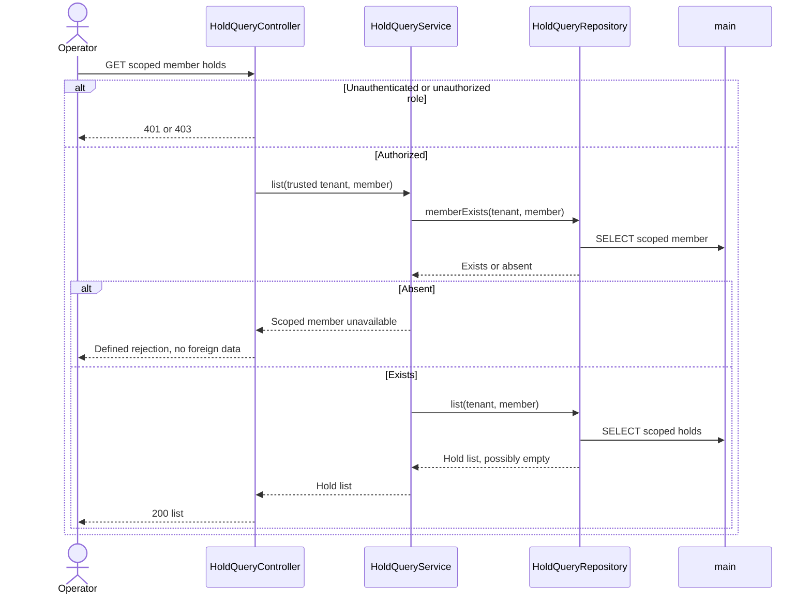
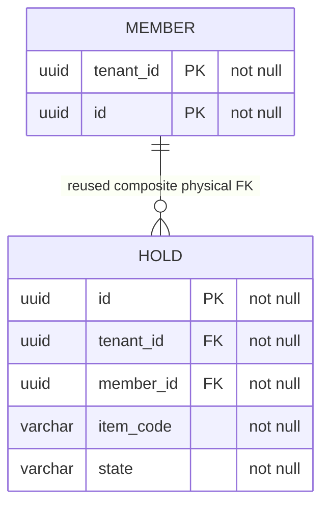

# Document applicability boundary examples

These are **focused synthetic excerpts**, not complete delivery documents or execution evidence. A real new technical design retains all ten chapters and all template subtopics, including a factual explanation where inapplicable. Scope determines the diagrams; perceived simplicity does not.

## SQL-only index change

Commission: add an index for an existing audit query; no service code, API or UI change. PostgreSQL 15 fixture table audit_event has id UUID PK, tenant_id UUID not null, created_at timestamptz not null and event_type varchar(40) not null. Query: tenant_id equality, created_at descending, limit 100. Add `(tenant_id, created_at DESC)`; actual planner/cost evidence is still needed.

| Design responsibility | Concrete content |
| --- | --- |
| Architecture/operation | Authorized database change in main; existing audit reader is reused, not a modified business operation |
| Backend/classes | No backend logic changed. No invented classDiagram or new HTTP processing chain |
| Data | Table grain: one emitted audit event; existing fields listed above. Index-only target still has an ER diagram and access/index table |
| Frontend/interfaces | No page, component or wire contract change; retain these headings with this reason |
| SQL/recovery | database.sql: target/schema evidence, duplicate-index check, CREATE INDEX transaction/locking plan, pg_indexes and EXPLAIN result checks, unknown commit inspection, reviewed DROP INDEX recovery |
| Remaining risk | Table size and maintenance-window locking unknown; hold execution readiness until checked, not “not applicable” |

No relation is invented for an unrelated single table. A change to a query or consumer would expand the operation/module inventory and require its actual chain.

## Non-class Python CLI, no persistence

Commission: normalize a supplied item code and print JSON. Python 3 fixture, new `app/main.py:run`, `app/normalize.py:normalize_code`, `app/output.py:write_result`; no service, database or UI. Accept 1–32 ASCII letters/digits/hyphen after trimming; uppercase output. Invalid input exits 2 with JSON error; valid exits 0. No persistent side effects.

| Function | Input/output | Dependencies and effect |
| --- | --- | --- |
| run | argv → exit code | normalize_code then write_result; process exit |
| normalize_code | str → normalized str or ValueError | No external dependency or I/O |
| write_result | result/error object → None | JSON to stdout; no file write |

Use a module/function dependency diagram instead of fabricated classes. Keep data model subsections with the reason “no persistence; only an input/output value”; no ER, SQL or persistent state machine. Keep frontend subsections with “CLI only”. Contract overview describes JSON success/error and exit codes, not a fabricated OpenAPI.

## Backend-only reuse of relational tables

Commission: add GET /members/{id}/holds for authenticated operators in their tenant; no frontend or schema changes. Fictional Kotlin HoldQueryController.query → HoldQueryService.list → HoldQueryRepository.list. Data: reuse member and hold from the [reservation model](reservation/tech-design.md#52-entity-relationships), with the same composite member relationship. Return an empty array for an existing scoped member with no holds; forbidden/missing member uses a defined rejection, never another tenant's rows.

| Design responsibility | Concrete content |
| --- | --- |
| Operations/classes | Inventory all three new classes and the directly used trusted auth context; methods have tenant/member inputs and list/error outputs; classDiagram required |
| Sequence | Authenticate → scoped member lookup → holds query → response; authentication/member failure branches required; no invented write transaction |
| Data | Reused member and hold still require ER, relevant fields and index/access analysis; no SQL artifact without an actual schema/data change |
| Frontend | No page/component modified, so chapter 6 explicitly records that fact. Backend design is still detailed |
| Tests | Existing/no-holds/missing/foreign-tenant cases; assert stored data unchanged and response scope, not just status 200 |

This excerpt describes applicability, not a complete approved design. The full [template](../../skills/aimship/references/templates/tech-design.md) still requires the inventories, diagrams and details before design completion.

The backend-only query inventory expands to these concrete methods:

| Class/path | Method and input/output | Responsibility |
| --- | --- | --- |
| src/query/HoldQueryController.kt | query(TenantMember, memberId) → HTTP list/error | Authenticate operator; validate memberId |
| src/query/HoldQueryService.kt | list(tenantId, memberId) → Hold list/error | Check scoped member, then list holds |
| src/query/HoldQueryRepository.kt | memberExists(tenantId, memberId) → boolean; list(tenantId, memberId) → Hold list | Read only; never accept an untrusted tenant override |

Both tables are reused in main, with no DDL. The existing hold tenant/client-key index does not by itself establish the cost of a tenant/member list query; inspect actual cardinality and plan before deciding whether an index change is necessary. This unknown remains visible rather than being called inapplicable.
