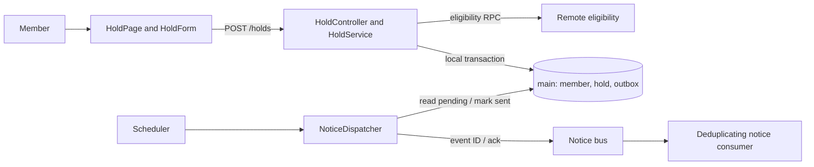
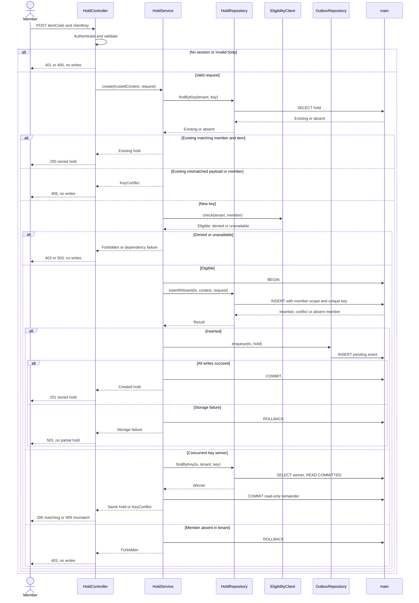
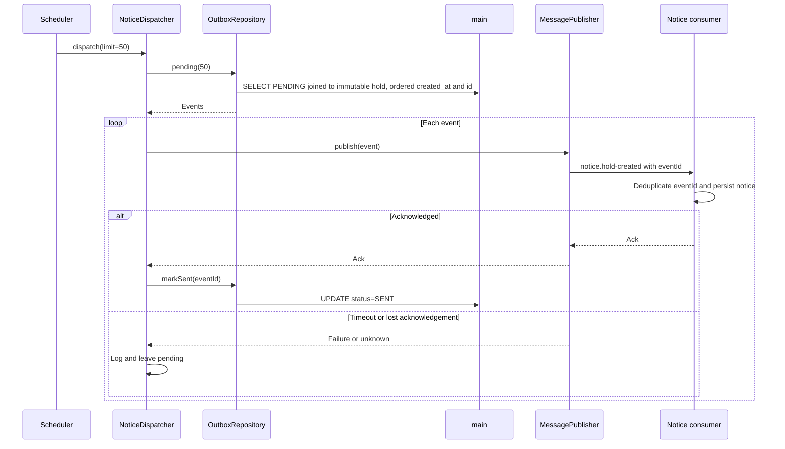
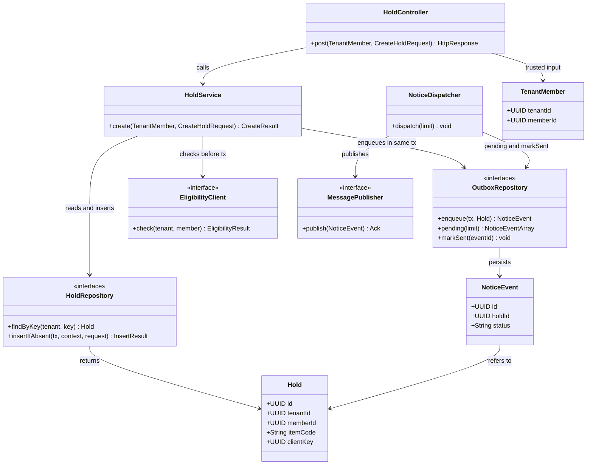
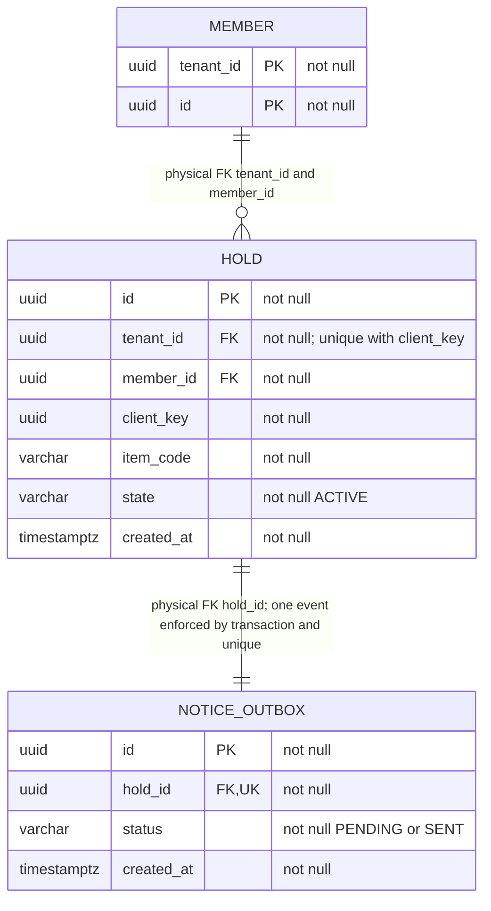
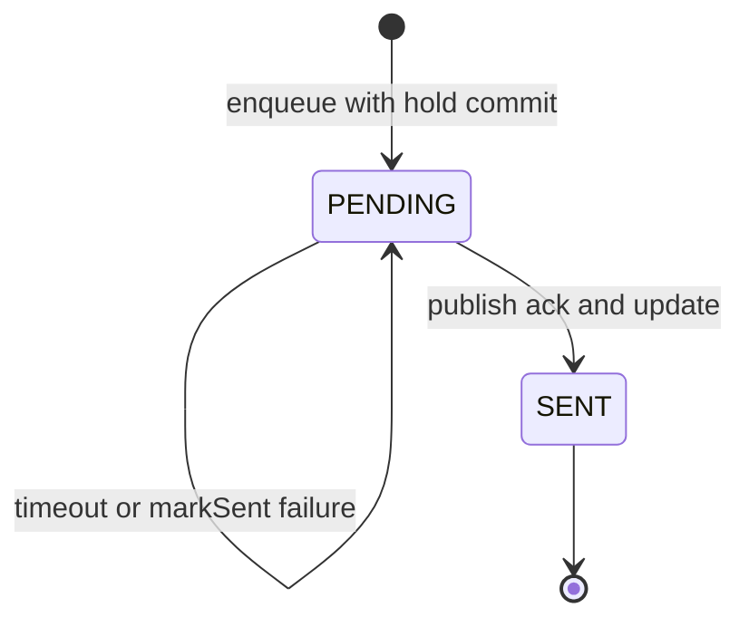
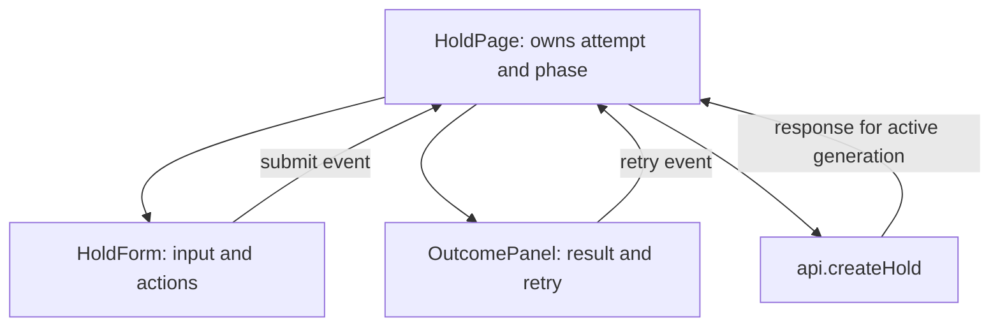

# Reservation example: tech-design

Delivery: synthetic-reservation; document revision: 1. Basis: the [example commission](README.md). Hand-authored design example; no application implementation, user approval or execution is claimed.

A trusted member creates one hold per client key. A local transaction stores the hold and an outbox event; a later dispatcher publishes the notice.

**Contents**

- [1. Summary and design basis](#1-summary-and-design-basis)
- [2. System architecture and connections](#2-system-architecture-and-connections)
- [3. Operations and processing flows](#3-operations-and-processing-flows)
- [4. Backend modules and classes](#4-backend-modules-and-classes)
- [5. Data model and consistency](#5-data-model-and-consistency)
- [6. Frontend design](#6-frontend-design)
- [7. Interface overview](#7-interface-overview)
- [8. Permissions, performance and recovery](#8-permissions-performance-and-recovery)
- [9. Migration, tradeoffs and risks](#9-migration-tradeoffs-and-risks)
- [10. Requirement coverage and questions](#10-requirement-coverage-and-questions)

## 1. Summary and design basis

### 1.1 Goal and proposal

Implement REQ-001 through REQ-003 using a Kotlin hold service, PostgreSQL local transaction/outbox and a React form. Confirmation acknowledges storage, not notice delivery.

### 1.2 Requirement and engineering basis

Basis: [PRD](prd.md). Synthetic baseline `fixture-v1`: service repo `hold-service`, Kotlin/JDBC; web repo `hold-web`, React; PostgreSQL 15 database `main`; existing member PK `(tenant_id,id)`. Identity middleware supplies trusted TenantMember. Eligibility RPC and notice consumer contracts are assumed fixture inputs, not observed real services.

### 1.3 Changes and review focus

Add hold/outbox tables, create endpoint, dispatcher and form. Assess tenant-scoped idempotency, eligibility timing, transaction/outbox atomicity, acknowledgement loss and frontend uncertain-result handling.

## 2. System architecture and connections

### 2.1 Repository and module boundaries

| Repository/module | Responsibility | Owned data | Caller/callee | Change/source |
| --- | --- | --- | --- | --- |
| hold-web/form | Draft, submit/retry, result | Session attempt | Member / hold API | New src/holds |
| hold-service/holds | Identity-bound create | main.member/hold/outbox | Form / eligibility | New src/holds; reused auth |
| hold-service/dispatch | Publish pending events | main.outbox | Scheduler / notice bus | New src/dispatch |
| eligibility | Check current member eligibility | Remote, never locally written | HoldService | Reused contract fixture |
| notice | Deduplicate and deliver notices | Remote, never locally written | Dispatcher | Reused contract fixture |

### 2.2 Architecture diagram

### 2.3 Connections and dependencies

| Caller | Provider/destination | Protocol/context | Sync/async | Configuration | Failure |
| --- | --- | --- | --- | --- | --- |
| HoldForm | POST /holds | HTTPS; authenticated session | Sync | web API base | Preserve uncertain attempt |
| HoldService | Eligibility.check | RPC; trusted tenant/member | Sync before transaction | eligibility.timeoutMs=800 fixture choice | 503, no write |
| NoticeDispatcher | notice.hold-created | JSON event; service identity | Async processing, sync publish ack | publisher.timeoutMs=1000; pollMs=5000 fixture choices | Retain pending |

## 3. Operations and processing flows

### 3.1 Operation inventory

| Operation | Trigger/entry | REQ/AC | Module | Read/write | Return/side effect | Chain |
| --- | --- | --- | --- | --- | --- | --- |
| createHold | POST /holds; form submit/retry | REQ-001, AC-001, AC-002 | HoldService | member/hold; insert hold/outbox | Stored hold; later notice | 3.3 |
| dispatchNotices | Scheduler tick | REQ-002, AC-003 | NoticeDispatcher | Read/update outbox | Remote publish | 3.4 |
| resetDraft | Form reset | REQ-003, AC-004 | HoldPage | Session draft only | Clear draft/new key | 6.4 |
| leavePage | Navigation | REQ-003, AC-004 | HoldPage | Save pending/uncertain attempt | Dispose response generation | 6.4 |

### 3.2 Chain index

Create and same-key retry share the create chain, with replay/conflict branches shown. Dispatch has a different transaction and external-call order, so has its own diagram. Reset/navigation are local operations, not invented backend chains.

### 3.3 Processing chain details

Create chain (createHold; submit/retry):

The repository uses INSERT … SELECT from the scoped member and ON CONFLICT DO NOTHING; it distinguishes absence from the unique-key winner. A second statement under READ COMMITTED reads the committed winner. Outbox insert/commit failure rolls back both new records. Transport loss after commit is an uncertain client result; retry returns the original hold. Eligibility is checked before the transaction and can change afterward.

### 3.4 Notice dispatch chain

No database transaction spans the external publish. Crash after delivery but before markSent repeats the same event ID; consumer uniqueness prevents duplicate notice records. MarkSent failure leaves pending. This is at-least-once, not exactly-once transport.

## 4. Backend modules and classes

### 4.1 Modules and locations

New `hold-service/src/holds` owns endpoint/application persistence. New `hold-service/src/dispatch` owns scheduled publishing. Reused `hold-service/src/auth/TenantMember.kt` represents middleware-verified context. No framework internals are changed.

### 4.2 Class inventory

| Repo/path | Class/interface | Change | Responsibility/methods | Direct dependencies | Requirement |
| --- | --- | --- | --- | --- | --- |
| hold-service/src/holds/HoldController.kt | HoldController | New | post | HoldService, TenantMember | REQ-001 |
| hold-service/src/holds/HoldService.kt | HoldService | New | create | HoldRepository, EligibilityClient, OutboxRepository | REQ-001 |
| hold-service/src/holds/HoldRepository.kt | HoldRepository | New interface/JDBC implementation | findByKey, insertIfAbsent | main; Hold | REQ-001 |
| hold-service/src/holds/Hold.kt | Hold | New data class | Stored identity and item | TenantMember reference | REQ-001 |
| hold-service/src/holds/OutboxRepository.kt | OutboxRepository | New interface/JDBC implementation | enqueue, pending, markSent | main; NoticeEvent | REQ-001, REQ-002 |
| hold-service/src/holds/NoticeEvent.kt | NoticeEvent | New data class | Immutable event payload | Hold | REQ-002 |
| hold-service/src/dispatch/NoticeDispatcher.kt | NoticeDispatcher | New | dispatch | OutboxRepository, MessagePublisher | REQ-002 |
| hold-service/src/clients/EligibilityClient.kt | EligibilityClient | Reused fixture interface | check | Remote eligibility | REQ-001 |
| hold-service/src/clients/MessagePublisher.kt | MessagePublisher | Reused fixture interface | publish | notice bus | REQ-002 |
| hold-service/src/auth/TenantMember.kt | TenantMember | Reused fixture data class | tenantId, memberId | Auth middleware | PERM-001 |

### 4.3 Class diagrams by module

Kotlin data classes have no new behavior methods. Repository interfaces include their JDBC implementation responsibility at the same source location in this synthetic plan; no generated accessors or framework classes are expanded.

### 4.4 Method responsibilities

| Symbol | Inputs | Result | Validation/read-write/calls | Error |
| --- | --- | --- | --- | --- |
| HoldController.post | Trusted TenantMember, CreateHoldRequest | HTTP response | Validate body; call create; translate result | 400/401/403/409/503 |
| HoldService.create | Same | Created or existing Hold | Compare existing owner/item; eligibility; local transaction for insert+event | No partial records |
| HoldRepository.findByKey | Tenant UUID, client key UUID; optional tx | Hold or absent | Tenant-scoped SELECT | Storage failure |
| HoldRepository.insertIfAbsent | Tx, context, request | Inserted/conflict/member-absent | INSERT SELECT scoped member; unique-key guard | Storage failure rolls back |
| OutboxRepository.enqueue | Same Tx, Hold | NoticeEvent | Generate immutable event ID, INSERT PENDING | Roll back enclosing transaction |
| OutboxRepository.pending | Integer limit | Events ordered created_at/id | Read PENDING joined to immutable hold payload, no claim of exclusive lease | Storage failure, retry next tick |
| OutboxRepository.markSent | Event UUID | Unit | Conditional update PENDING to SENT | Leave pending on failure |
| EligibilityClient.check | Trusted tenant/member UUIDs | Eligible/denied | Remote RPC; no local writes | Unavailable |
| NoticeDispatcher.dispatch | Limit=50 | Unit | pending → publish → markSent | Per-event failure logged, next tick retries |
| MessagePublisher.publish | NoticeEvent | Ack | Publish fixed event ID; wait for ack | Unknown/timeout |

Wire fields are defined in [OpenAPI](openapi.yaml) and [non-HTTP contracts](rpc.md).

## 5. Data model and consistency

### 5.1 Tables and data grain

| Database/table | Change | One row | Creation/update | Readers/writers | Requirement |
| --- | --- | --- | --- | --- | --- |
| main.member | Reused, no DDL | Member within tenant | Existing membership flow | HoldRepository reads scoped identity | PERM-001 |
| main.hold | New | One stored request per tenant/client key | Create once, immutable in scope | HoldRepository | REQ-001 |
| main.notice_outbox | New | One notice event per hold | Enqueue; mark SENT on ack | OutboxRepository | REQ-002 |

### 5.2 Entity relationships

All entities are in database main. The FK is physical; exactly one event per new hold also needs the application transaction (FK alone does not enforce child existence). Member fields shown are only those used; no remote eligibility/notice database is locally queried.

### 5.3 Fields

| Table.field | Type | Null/default | Meaning/source | Constraint/change |
| --- | --- | --- | --- | --- |
| member.tenant_id | uuid | No/no default | Trusted tenant | Existing composite PK |
| member.id | uuid | No/no default | Trusted member | Existing composite PK |
| hold.id | uuid | No/no default | Server-generated identity | New PK |
| hold.tenant_id | uuid | No/no default | Trusted context | New FK part; unique key part |
| hold.member_id | uuid | No/no default | Trusted context | New FK part |
| hold.client_key | uuid | No/no default | Client attempt identity | New unique with tenant |
| hold.item_code | varchar(32) | No/no default | Requested item | New; ASCII code validation |
| hold.state | varchar(8) | No/ACTIVE | Stored state | New; CHECK ACTIVE |
| hold.created_at | timestamptz | No/CURRENT_TIMESTAMP | Server creation time | New |
| notice_outbox.id | uuid | No/no default | Server event identity | New PK |
| notice_outbox.hold_id | uuid | No/no default | Associated hold | New unique FK |
| notice_outbox.status | varchar(7) | No/PENDING | Delivery work state | New CHECK PENDING/SENT |
| notice_outbox.created_at | timestamptz | No/CURRENT_TIMESTAMP | Enqueue time | New |

### 5.4 Indexes and access

| Table | Access | Index/order | Uniqueness/cost basis |
| --- | --- | --- | --- |
| member | tenant_id + id lookup | Existing composite PK | Unique scoped identity |
| hold | tenant_id + client_key | New unique(tenant_id,client_key) | Atomic idempotency, not just query speed |
| hold | id lookup for dispatch payload | New PK(id) | Point lookup |
| notice_outbox | hold_id join | New unique(hold_id) | One event per hold |
| notice_outbox | PENDING ordered created_at,id LIMIT 50 | New partial(created_at,id) WHERE status=PENDING | Cardinality/cost not measured; explain plan pending |

### 5.5 States and transitions

| Object/from | Trigger/guard | To | Effects | Forbidden |
| --- | --- | --- | --- | --- |
| Hold/absent | Eligible atomic insert | ACTIVE | Event PENDING in same tx | No persisted cancellation in scope |
| Event/PENDING | Publish ack | SENT | Conditional update | No SENT on timeout |
| Event/PENDING | Failure | PENDING | Same event retried | No changed event ID |

Form states are separate in 6.3; they cannot change persisted event status.

### 5.6 Transactions and concurrency

| Invariant | Check/enforcement | Boundary | Retry/window |
| --- | --- | --- | --- |
| One hold per tenant/key | DB unique index; compare member/item on replay | INSERT conflict then new READ COMMITTED statement | Concurrent losers read winner; mismatched use returns 409 |
| Member belongs to tenant | INSERT SELECT + composite FK | Local transaction | Concurrent deletion cannot leave orphan |
| Hold and event both present | Two inserts in same tx | Commit or rollback both | Lost response uses same key |
| Eligibility | RPC before write | Outside local transaction | Eligibility may change before commit; no stronger guarantee |
| Event delivered at least once | Retained pending + repeated publish | External ack before markSent | Ack-loss duplicates; consumer event-ID uniqueness required |

### 5.7 SQL delivery plan

One PostgreSQL 15 target main; [database.sql](database.sql) creates hold, notice_outbox and indexes after checking member PK and absent names. No existing member DDL. Apply schema before new code; do not start dispatcher until consumer dedup is available. The script is supplied but unexecuted.

## 6. Frontend design

### 6.1 Pages, routes and entry points

| Route | Repo/file | Entry/role | Requirement | Change |
| --- | --- | --- | --- | --- |
| /holds/new | hold-web/src/holds/HoldPage.tsx | Member menu/authenticated member | REQ-003, AC-004 | New |

### 6.2 Components and relationships

| File/name | Responsibility | Inputs/outputs | Change/relationship |
| --- | --- | --- | --- |
| src/holds/HoldPage.tsx | Own attempt/state | Route context; submit/reset handlers | New parent |
| src/holds/HoldForm.tsx | Input/validation/buttons | draft, phase; change/submit/reset events | New child |
| src/holds/OutcomePanel.tsx | Error/confirmation | result/error; retry event | New child |
| src/holds/api.ts | Typed HTTP call | request + abort signal → response | New directly used function |

### 6.3 State and data flow

| State | Owner/source | Operations | Persistence/reset |
| --- | --- | --- | --- |
| draft item | HoldPage/input | Edit when not pending/uncertain | Session attempt while uncertain; reset when allowed |
| clientKey + submitted payload | HoldPage/generated UUID | Freeze for submit/retry | Session storage keyed by authenticated member/tenant; clear on success/logout |
| phase | HoldPage | idle → pending → success/definite-error/uncertain | Restore uncertain attempt on return; never auto-submit |
| generation token | HoldPage/mount | Response applies only to active generation | Dispose on navigation; ignore late response |
| hold/error | HoldPage/response | OutcomePanel render | Success clears attempt, error retains relevant data |

No state management library added. Session data contains item/key, no session credential.

### 6.4 Operations, validation and recovery

Submit validates item pattern and freezes key/payload; api.createHold maps to 3.3. Pending disables submit/reset. Retry after timeout sends the frozen request with the same key. Definite 400/403/409 permits edits/reset and a new attempt key; 503/transport failure conservatively retains the attempt. Reset only clears local state when allowed; it never cancels a hold. Navigation during pending/uncertain warns that work may complete, retains attempt and disposes the response token; returning offers same-key retry. Blank input shows instructions; unauthorized response asks for sign-in, without leaking other-tenant data.

## 7. Interface overview

### 7.1 HTTP operations

| operationId | Method/path | Purpose | Caller/provider | Auth/scope | Types/location |
| --- | --- | --- | --- | --- | --- |
| createHold | POST /holds | Create or recover stored hold | HoldPage / HoldController | Session tenant/member | CreateHoldRequest/HoldResponse/Error in [OpenAPI](openapi.yaml) |

### 7.2 RPC, messages and other protocols

EligibilityClient.check calls the read-only eligibility provider; NoticeDispatcher emits notice.hold-created to a deduplicating consumer. Exact signatures, fields and error/retry behavior are in [rpc.md](rpc.md).

### 7.3 Contract ownership and production

No real engineering contract exists in this fictional example. openapi.yaml and rpc.md are the sole wire authorities here. The design references types without maintaining another complete schema.

## 8. Permissions, performance and recovery

### 8.1 Identity and data permissions

| Operation | Trusted context | Scope/enforcement | Denial |
| --- | --- | --- | --- |
| createHold | Auth middleware TenantMember | Repository tenant/member selection; request has no identity fields | 401/403 no writes; key owned by another member yields generic 409 |
| dispatchNotices | Service scheduler identity | main pending events; service publisher credentials | Failed publish leaves PENDING |

### 8.2 Call cost and performance

New create: one duplicate lookup, at most one eligibility RPC, one scoped insert and one event insert. Replay: one lookup, no RPC. Concurrent loser: conflict then one lookup. Dispatch: 50 pending per tick, one joined hold lookup in the pending query, then per event one publish and one conditional update. Timeouts/poll limits are fixture design choices in 2.3, not measured capacity. Query plans and backlog recovery timing remain unmeasured.

### 8.3 Cache and messages

No cache changes. Event enqueue occurs before local commit, visibility after commit; publish occurs later without a spanning transaction. Consumer must deduplicate eventId, not itemCode. Multiple dispatchers may duplicate delivery; no ordering guarantee across distinct holds.

### 8.4 Errors, timeout and recovery

| Trigger | Visible result | Data/side effect | Recovery |
| --- | --- | --- | --- |
| Invalid/no session | 400/401 | No writes | Correct input/sign in |
| Ineligible/missing member | 403 | No writes | Resolve eligibility/scope |
| Key mismatch | 409 | Existing hold unchanged | Do not expose it; new attempt only after user correction |
| Eligibility unavailable | 503 | No writes | Same-key retry |
| DB failure before commit | 503 | Transaction rolls back | Same-key retry |
| Response lost after commit | Client uncertain | Hold/event may exist | Same-key retry returns original |
| Publish/markSent failure | Internal retry | Pending; remote notice may exist | Same event ID plus consumer dedup |

### 8.5 Observability

Log request correlation ID, operation, tenant ID, hold/event ID and outcome category; do not log cookies or item payload by default. Record pending age/count and publish failures. No alert threshold is claimed until deployment workload is known.

## 9. Migration, tradeoffs and risks

### 9.1 Migration and rollback

Order: inspect schema → apply reviewed SQL → verify indexes/FKs → enable consumer dedup → deploy service/web → enable dispatcher. Stop dispatcher before code rollback. Retain populated tables and pending events; dropping tables is destructive and requires a separate decision/backup. No execution has occurred.

### 9.2 Technical choices

Use transactional outbox rather than inline best-effort notice to preserve committed work through outages. Use database unique key instead of only an application precheck for concurrent retries. Do not hold a DB transaction open across eligibility or publish calls; consequence is the explicit eligibility window and at-least-once message delivery.

### 9.3 Remaining risks

Consumer dedup and eligibility contracts are fixture assumptions requiring real evidence before implementation. Session storage can be cleared by the user; recovery then requires a later support/read capability outside this example. No delivery deadline or measured backlog capacity is promised. These are visible limits, not hidden evidence notes.

## 10. Requirement coverage and questions

### 10.1 Requirement and acceptance coverage

| Reference | Operation | Module/data | Frontend | Contract/design |
| --- | --- | --- | --- | --- |
| REQ-001, AC-001, AC-002, PERM-001, EC-001 | createHold | HoldService, member/hold/outbox | submit/retry | openapi.yaml; 3.3, 4, 5, 8 |
| REQ-002, AC-003 | dispatchNotices | NoticeDispatcher, outbox | No direct UI delivery claim | rpc.md; 3.4, 5, 8 |
| REQ-003, AC-004 | submit/reset/leave/retry | api function; no local DB write | HoldPage/Form/OutcomePanel | 6; createHold contract |

### 10.2 Questions and gaps

No unresolved product choice is invented inside the synthetic commission. Real implementation is blocked on replacing fixture schema/contract assumptions with observed evidence and on providing a test environment; these limits remain in 1.2, 9.3 and testing.

